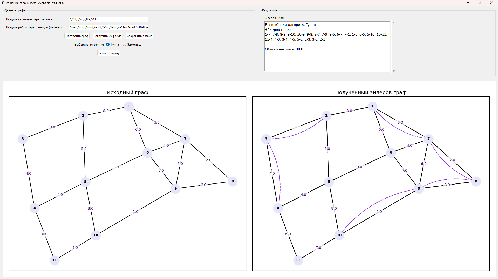

# Chinese Postman Problem Solver

Приложение на Python для решения задачи китайского почтальона с визуализацией графов и найденных маршрутов.

## О проекте

Задача китайского почтальона заключается в поиске кратчайшего замкнутого маршрута, который проходит по каждому ребру графа хотя бы один раз.

Проект разработан для изучения алгоритмов оптимизации маршрутов и их программной реализации.

## Реализованные алгоритмы

- Алгоритм Гуаня
- Алгоритм Эдмондса

## Возможности

- Работа с графами
- Поиск маршрута, проходящего по всем рёбрам
- Визуализация графа и результата
- Графический интерфейс пользователя

## Технологии

- Python
- NetworkX
- Matplotlib
- Tkinter

## Структура проекта

- `AlgorithmSolver.py` — алгоритмы решения задачи
- `GraphManager.py` — создание и обработка графов
- `Visualizer.py` — визуализация
- `ChinesePostmanApp.py` — графический интерфейс

## Установка и запуск

1. Склонировать репозиторий.
2. Установить зависимости:

```bash
pip install -r requirements.txt
```

3. Запустить приложение:

```bash
python ChinesePostmanApp.py
```

## Статус

Учебный проект по реализации алгоритмов на графах.

## Пример работы приложения

На примере графа из 11 вершин программа строит
маршрут с помощью алгоритма Гуаня и визуализирует
дополнительные проходы по рёбрам.

Общий вес полученного маршрута: 98,0.


